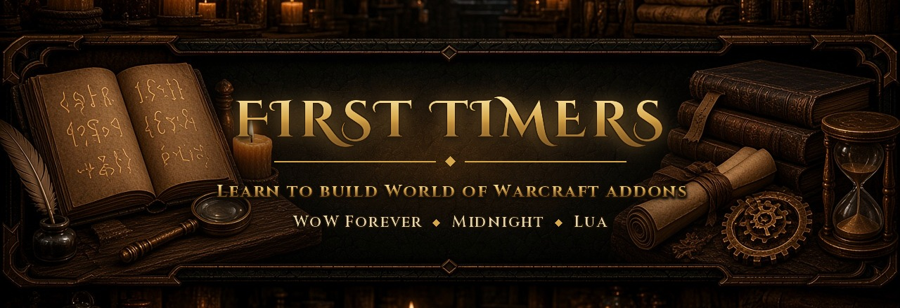

<p align="center">
  
</p>

<p align="center">
  <b>A beginner's library for writing World of Warcraft addons on WoW Forever and Midnight.</b><br>
  Tutorials, references, notes from real addons, and a starter addon that runs on both clients.
</p>

<p align="center">
  
  
  
  
</p>

---

## Contents

- [Who this is for](#who-this-is-for)
- [Quick start](#quick-start)
- [Learning path](#learning-path)
- [What's inside](#whats-inside)
- [External sources](#external-sources)
- [Which source to trust](#which-source-to-trust)
- [Repository layout](#repository-layout)
- [Tips for first timers](#tips-for-first-timers)
- [Credits and licenses](#credits-and-licenses)

## Who this is for

You play WoW, you've used addons, and you want to make your own. You don't need to know Lua yet. Everything here targets the two modern clients:

| Client | Interface | Notes |
|--------|-----------|-------|
| **WoW Forever** | `16001` | Classic-style content on a modern client (`C_Spell`, `C_Item`, Settings API, secret values). Not the same as Classic Era. |
| **Midnight** (retail) | `120105` / `120107` | Patch 12.x. Secret values and no combat log for addons. |

## Quick start

```bash
git clone https://github.com/Terynas/First-Timers.git
cd First-Timers
bash sync.sh        # downloads the external sources listed below (about 220 MB)
```

Then try the starter addon:

1. Copy `07-starter/HelloAzeroth/` into your client's `Interface/AddOns/` folder.
2. Fully restart the game. `/reload` isn't enough after adding a new addon.
3. Type `/hello` in chat.

Run `bash sync.sh` again whenever you want the latest docs (`bash sync.sh docs` refreshes only the guide pages, which is quick).

## Learning path

1. **Your first addon.** Read [`01-guides/wiki/01-getting-started.md`](01-guides/wiki/01-getting-started.md) (Hello World in 15 minutes), then open `07-starter/HelloAzeroth/` and read its two files line by line.
2. **The building blocks.** Work through the numbered wiki tutorials in [`01-guides/wiki/`](01-guides/wiki/): TOC files, the loading process, events, saved settings, slash commands, localization, taint, XML.
3. **What's different on modern clients.** Read the [Midnight 12.0.0 API changes](01-guides/wiki/midnight-12.0.0-api-changes.md) and [`06-notes/addon-dev/midnight-12.md`](06-notes/addon-dev/midnight-12.md). Forever inherits most of these changes.
4. **Forever specifics.** Read [`06-notes/forever-rules.md`](06-notes/forever-rules.md), [`06-notes/forever-quirks.md`](06-notes/forever-quirks.md) and the [Forever 1.60.1 API changes](01-guides/wiki/forever-1.60.1-api-changes.md), then the [Forever developer series](#external-sources) (downloaded into `01-guides/forever/` by `sync.sh`).
5. **Going further.** Topic notes in [`06-notes/addon-dev/`](06-notes/addon-dev/) cover secure templates and combat lockdown, debugging, Ace3, and packaging for CurseForge. Bigger examples are in [`07-starter/more-examples/`](07-starter/more-examples/).

## What's inside

| Folder | What you'll find |
|--------|------------------|
| [`01-guides/wiki/`](01-guides/wiki/) | 17 Warcraft Wiki pages as Markdown. Numbered files are tutorials in reading order; `ref-*` files list every API function, event, widget method, script handler and CVar. |
| [`06-notes/`](06-notes/) | Notes written while building and shipping real addons: Forever rules, machine-verified Forever quirks, and ten topic guides. |
| [`07-starter/HelloAzeroth/`](07-starter/HelloAzeroth/) | A minimal addon for both clients: event handling, a slash command, saved settings and Forever detection. |
| [`07-starter/more-examples/`](07-starter/more-examples/) | Ace3 addon, options panel, addon-to-addon messages, boss encounter handling, multi-version TOCs. Their TOCs say `120005`; update `## Interface:` before loading them. |
| [`sync.sh`](sync.sh) | Downloads and updates everything in [External sources](#external-sources). |

## External sources

These aren't stored in this repo. They belong to their authors and change with every patch, so `sync.sh` downloads them straight from the source into the folder shown.

| Source | What it is | Local folder | License |
|--------|------------|--------------|---------|
| [**Gethe/wow-ui-source**](https://github.com/Gethe/wow-ui-source) ([`live`](https://github.com/Gethe/wow-ui-source/tree/live), [`forever`](https://github.com/Gethe/wow-ui-source/tree/forever)) | Blizzard's own UI code (FrameXML) and the generated API documentation for each client | `03-blizzard-source/` | Blizzard's code; mirror, no license |
| [**Ketho/BlizzardInterfaceResources**](https://github.com/Ketho/BlizzardInterfaceResources) ([`live`](https://github.com/Ketho/BlizzardInterfaceResources/tree/live), [`forever`](https://github.com/Ketho/BlizzardInterfaceResources/tree/forever)) | Plain lists of every global function, event, frame, template, texture atlas and string | `04-interface-resources/` | none declared |
| [**Atraeau/WoW-Addons**](https://github.com/Atraeau/WoW-Addons) | Forever API definitions generated from the Forever client ([browse online](https://atraeau.github.io/WoW-Addons/)) | `02-api-docs/forever-api-dump/` | none declared |
| [**BigWigsMods/packager**](https://github.com/BigWigsMods/packager) | The release packager CurseForge, Wago and WoWInterface projects use to build zips | `05-libraries/packager/` | none declared |
| [**wowforeverguides.com addon series**](https://wowforeverguides.com/addons/developers) | Forever developer guide: [guide](https://wowforeverguides.com/addons/developers), [patterns](https://wowforeverguides.com/addons/patterns), [API cheat sheet](https://wowforeverguides.com/addons/api-cheatsheet), [pitfalls](https://wowforeverguides.com/addons/pitfalls), [code templates](https://wowforeverguides.com/addons/code-templates) | `01-guides/forever/` | site content, all rights reserved |
| [**Ketho/vscode-wow-api**](https://github.com/Ketho/vscode-wow-api) | Type annotations for the whole API. Install the [VS Code extension](https://marketplace.visualstudio.com/items?itemName=ketho.wow-api) for autocomplete and inline docs | `02-api-docs/vscode-wow-api/` | MIT |
| [**WoWUIDev/Ace3**](https://github.com/WoWUIDev/Ace3) | The most widely used addon framework (addon objects, events, profiles, config UI), includes LibStub | `05-libraries/Ace3/` | BSD-style |

Also worth bookmarking: [Warcraft Wiki: World of Warcraft API](https://warcraft.wiki.gg/wiki/World_of_Warcraft_API) and the in-game `/api` command.

## Which source to trust

When two sources disagree:

- **Forever:** the client's generated docs win: `03-blizzard-source/forever/Interface/AddOns/Blizzard_APIDocumentationGenerated/`, or `/api` in game. The Atraeau dump is easier to search but can lag a build behind. Then check [`06-notes/forever-quirks.md`](06-notes/forever-quirks.md) for behaviour that only shows up at runtime.
- **Midnight:** `03-blizzard-source/midnight-live/Interface/AddOns/Blizzard_APIDocumentationGenerated/`, then the wiki.
- **Forever is not Classic.** Code copied from Classic Era addons usually needs rewriting for the modern APIs.

Handy searches once `sync.sh` has run:

```bash
rg -n "GetItemInfo" 03-blizzard-source/forever/Interface/AddOns/Blizzard_APIDocumentationGenerated/
rg -n "MAIL_SHOW" 04-interface-resources/*/Resources/Events.lua
rg -n "^## " 01-guides/wiki/ref-events.md | rg -i trade
```

## Repository layout

```text
First-Timers/
├── 01-guides/
│   ├── wiki/                  Warcraft Wiki tutorials + references (in repo)
│   └── forever/               wowforeverguides.com series (sync.sh)
├── 02-api-docs/               Forever API dump, vscode-wow-api (sync.sh)
├── 03-blizzard-source/        Blizzard UI source per client (sync.sh)
├── 04-interface-resources/    Globals, events, frames, atlases per client (sync.sh)
├── 05-libraries/              Ace3, packager (sync.sh)
├── 06-notes/                  Notes from shipping real addons (in repo)
├── 07-starter/                HelloAzeroth + more examples (in repo)
└── sync.sh                    Download / update script
```

## Tips for first timers

- **Restart the game after editing a `.toc` file.** `/reload` reloads Lua but not the addon list.
- **Turn on error messages** with `/console scriptErrors 1`, or install BugSack, so mistakes don't fail silently.
- **Use `/dump`** to inspect anything: `/dump C_Item.GetItemInfo(2318)`.
- **Set your event handler before registering events**, and read saved settings in `ADDON_LOADED`, not at file load.
- **Don't modify protected frames in combat.** Check `InCombatLockdown()` first.
- **Start small.** One file, one event, one slash command. HelloAzeroth is all three.

## Credits and licenses

- Warcraft Wiki pages in `01-guides/wiki/` are from [warcraft.wiki.gg](https://warcraft.wiki.gg) under [CC BY-SA 4.0](https://creativecommons.org/licenses/by-sa/4.0/). Each file names its source page at the top.
- External sources keep their own licenses (see [External sources](#external-sources)) and are downloaded from their authors; they aren't redistributed here.
- Notes in `06-notes/` and the starter addon were written by [Terynas](https://github.com/Terynas) while building the SnapPost and ProfessionMaster addons.
- World of Warcraft is a trademark of Blizzard Entertainment. This project isn't affiliated with or endorsed by Blizzard.
